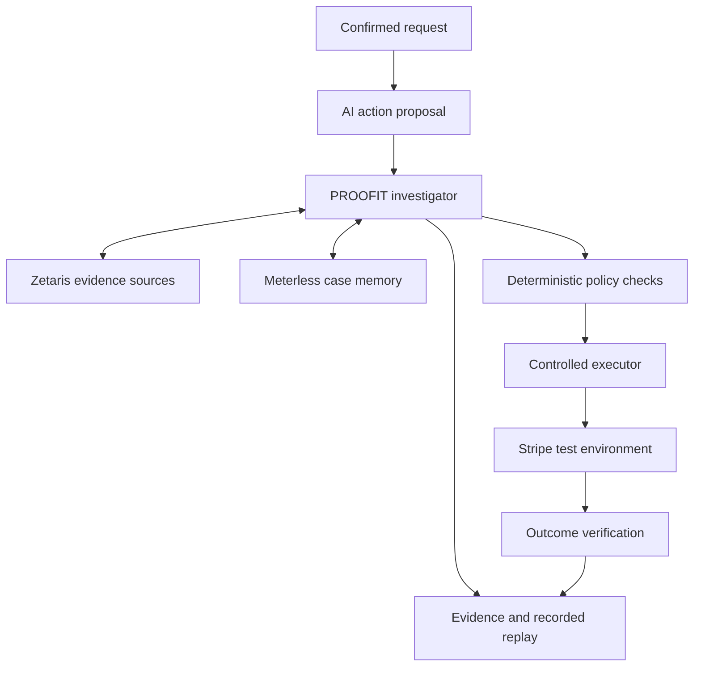

# PROOFIT — Verify the Action Before It Happens

**Tagline:** You proof it. You profit.  
**Project type:** Standalone Web2 application, built independently  
**Track:** Track 3 — Reasoning Architecture  
**Status:** Proposal and implementation plan; no implementation or evaluation results claimed

> PROOFIT investigates an AI-proposed financial action, checks it against the confirmed request, authoritative records, and approved business policy, and controls whether its executor may perform that exact action. It then verifies and accurately reports the recorded outcome.

## 1. Executive decision

Build a separate product with its own repository, application, data model, agent, and execution service. No prior project codebase, transaction decoder, wallet, blockchain, multisig, or on-chain signing infrastructure is required.

The first supported workflow is **subscription cancellation and refund requests** in a fictional subscription service, integrated with Stripe test mode or a Stripe sandbox.

This is one bounded customer-service workflow, not a universal financial security platform. It supports two explicit action types: schedule cancellation at the end of the current subscription period, or issue an explicitly authorised refund against a specified payment.

The project is more than a written-answer checker: an invalid or unauthorised action cannot reach the integrated executor. The original answer-checking idea remains as a final reporting safeguard: an assistant must not claim that an action completed when the recorded provider outcome does not support that statement.

**Core principle:** AI investigates evidence; code enforces permissions and action integrity; humans confirm ambiguous intent and approve required exceptions.

This document replaces the earlier proposal with the standalone project scope described above.

## 2. Problem, user, and value proposition

### Primary user

A developer or operations team deploying an AI customer-support agent that can modify subscriptions or initiate refunds.

### Problem

A provider API may accept an action that the customer or business did not authorise. Technical validity does not establish intent alignment.

Examples:

- A customer requests cancellation of the next renewal, but the agent proposes an immediate refund.
- A support reviewer approves a RM20 goodwill refund, but the agent proposes RM200.
- The agent selects a payment belonging to a different customer in the same business account.
- A previous request is still pending, but the agent creates another refund attempt.
- The provider accepted a refund request, but the assistant tells the customer the money has already reached their bank.

### Value proposition

PROOFIT connects the proposed action to evidence and explicit authority, identifies mismatches, and prepares a concise review packet. Its controlled executor carries out only an authorised action, while its observer records what actually happened.

**What must be proven:** the investigation improves evidence handling or reviewer effort beyond a properly implemented rules-based backend. Authorisation, identity, and duplicate prevention remain ordinary engineering requirements; their presence alone does not establish that an AI agent is necessary.

## 3. Main demonstration

### An otherwise valid but unauthorised refund

The customer has a paid annual subscription costing RM1,200. They select and confirm:

> Cancel my next renewal. Keep my current subscription active until the end of the paid period.

The proposing AI produces:

> Refund RM1,200 against the original payment and cancel service immediately.

The refund could be within the payment's refundable balance. The key defect is that it does not match the confirmed request.

PROOFIT:

1. Retrieves the authenticated request receipt and subscription record.
2. Retrieves the relevant approved cancellation/refund policy and payment context.
3. Identifies that a refund and immediate service termination were not authorised.
4. Blocks the proposed action without calling the refund API.
5. Shows the exact mismatch with source references.
6. Presents the already authorised end-of-period cancellation action through a fresh validation path.
7. Executes only the validated action and verifies its recorded subscription state.

It must not silently replace the proposed action with a materially different one and execute it. Any replacement must be independently bound to the customer's confirmed intent and applicable policy.

### Companion demonstrations

- A valid refund with an authenticated exact-amount approval executes once.
- An ambiguous request is held for clarification rather than interpreted as permission.
- A repeated request reuses its existing execution record rather than creating another operation.
- A pending outcome is reported as pending, with no unsupported completion claim.

Stripe already limits total refunds to the original payment amount. Detecting that same over-refund condition is not our principal differentiator. [S2]

## 4. Locked MVP scope

| Dimension | Decision |
| --- | --- |
| Application | Fictional subscription-service support console |
| Integration | One backend, one Stripe test environment |
| Supported actions | `CANCEL_AT_PERIOD_END` and `REFUND_PAYMENT` |
| Unsupported action | Immediate cancellation; hold rather than approximate |
| Currency | MYR; integer minor units for execution |
| Accounts | Small synthetic customer, subscription, payment, and request set |
| Customer intent | Authenticated structured confirmation with an explicit action type |
| Refund authority | Customer confirmation plus business eligibility and required staff approval |
| Policy | Small versioned configuration, linked to reviewed text clauses |
| Investigation | One bounded agent with typed read-only evidence tools |
| Execution | Separate deterministic service with provider credentials |
| Outcome | Provider retrieval and persistent reconciliation |

### Must ship

- A proposing support-agent integration that cannot directly execute financial actions.
- Exact-action request and approval receipts.
- Real evidence retrieval through Zetaris across two source systems.
- Real Meterless memory persistence and restart/resume behavior.
- A suitable NVIDIA model performing substantive investigation work.
- Deterministic validation and a protected execution endpoint.
- Real test-provider execution for at least one supported action of each type.
- An evidence-backed decision, recorded replay, and outcome report.
- A held-out evaluation against simpler alternatives.

### Exclusions

No live-money operations, wallet protection, transfers, trading, lending, personalised investment advice, arbitrary financial APIs, autonomous policy exceptions, universal chatbot interception, or claims of regulatory compliance.

No complex proration, tax, credits, multiple currencies, invoice adjustments, partial-period entitlement calculations, or combined multi-action transactions. Use test scenarios with explicit fixed refund amounts. Refer unsupported billing cases to a human.

No multi-agent courtroom or majority-vote execution authority. Optional independent review is an experiment, not an MVP dependency.

## 5. Critical assessment and competition

| Objection | Assessment | Required response |
| --- | --- | --- |
| This is ordinary backend validation. | Much of the enforcement is. | Include a strong rules-only baseline; measure the agent's incremental benefit. |
| Refund automation already exists. | Correct. Intercom Fin documents action-taking procedures and connectors. [S5] | Do not pitch this as the first refund agent. Focus on evidence investigation, exact authorisation, and truthful outcomes. |
| The AI can misunderstand the user's request. | Correct. | Free-text extraction can prefill a proposal, but cannot establish execution permission. |
| Multiple judges could agree on a wrong action. | Correct. | Require authoritative records and deterministic checks regardless of votes. |
| A checker is bypassable if the agent has the API key. | Correct. | Only the executor receives provider credentials; the proposing agent lacks an alternative execution route. |
| A provider timeout could cause a duplicate refund. | Correct. | Persist operation identity; reconcile uncertainty and reuse the same idempotency key when appropriate. |
| A source document can be obsolete or malicious. | Correct. | Use approved versions, exact evidence references, and explicit trust boundaries. |
| There is no established customer demand yet. | Unresolved. | Seek feedback from support-automation builders; do not claim validated adoption or ROI. |

Intercom's API guidance already calls out authenticated identity, authorisation responsibilities, and idempotency. These are existing concerns, not discoveries unique to PROOFIT. [S4]

**Differentiation hypothesis:** an inspectable investigation packet plus an enforced action binding can help teams resolve ambiguous or conflicting cases faster while preserving ordinary backend controls. Documentation research alone does not establish a market gap.

## 6. Authority and confirmation model

### Separate intent from permission

A customer's request is necessary context, but does not by itself establish merchant authorisation for a refund.

- **Customer confirmation** establishes the requested action, target, and amount where relevant.
- **Business policy** establishes eligibility, limits, and required staff roles.
- **Staff approval** establishes any required discretionary permission for a specific action.
- **Provider state** establishes what is currently possible and what has already occurred.

AI output, conversation text, memory, screenshots, and unsigned notes cannot create any of these permissions.

### Request receipt

An authenticated customer or operator confirms a structured action card. Store the receipt server-side with:

- Tenant and actor identity, roles, customer identity.
- Business request ID and version.
- Exact action type and target subscription or payment ID.
- For refunds: exact amount in minor units and currency.
- For cancellation: explicit end-of-period timing.
- Customer confirmation, applicable business approval, policy version.
- Creation time, expiry, one-time consumption state, and canonical parameter digest.

Identity comes from the authenticated session and trusted backend mapping. Never trust a chat-provided email or payment ID as proof of ownership.

Bind approval to exact parameters. Changes to action, target, amount, currency, actor, or policy invalidate it. The model cannot create a signed receipt or grant itself a larger spending limit.

## 7. Agent workflow

1. **Receive a proposed action:** store the proposal and original conversation context as untrusted inputs.
2. **Resolve trusted context:** retrieve the authenticated request receipt, customer mapping, subscription/payment records, and current policy version.
3. **Load case memory:** retrieve previous investigation references and unresolved questions for the same tenant and request version.
4. **Investigate:** choose additional evidence lookups based on missing or conflicting information. Follow policy references, request amendments, and previous-attempt records.
5. **Create findings:** identify mismatches, missing approvals, unsupported assumptions, or unresolved ambiguity. Cite exact evidence and distinguish facts from interpretations.
6. **Run code checks:** validate ownership, exact parameters, current provider state, policy constraints, approval roles, receipt expiry, and duplicate-attempt state.
7. **Decide:** allow eligibility for execution, block, or request clarification/review.
8. **Revalidate and reserve:** re-read authoritative state immediately before execution and atomically reserve the business operation.
9. **Execute:** the controlled service performs only the exact authorised supported call.
10. **Observe:** retrieve the resulting provider object and reconcile its status.
11. **Report:** use the recorded result to generate an accurate user-facing status.
12. **Persist:** save evidence, checks, outcome, and scoped memory references.

The workflow runs when a proposal enters the gateway. It is not a chatbot that requires a reviewer to manually request every evidence lookup.

### Where the agent adds value

The agent can connect narrative explanations to policy references, investigate inconsistent case notes, and identify what information is still needed. It should choose different retrieval paths for different evidence gaps.

It does not select an action by counting votes or infer authority from persuasive wording. If structured data completely resolves a case, code should handle it without unnecessary model calls.

## 8. Evidence sources and sponsor integrations

| Technology | Concrete role | Evidence to show |
| --- | --- | --- |
| **Zetaris** | Query customer/request/payment records plus a separate approved policy/case-document source | Real query references and a case using both source systems |
| **Meterless** | Persist unresolved issues and evidence pointers; retrieve them when reopening a case | Actual memory write/read references and resume after process restart |
| **NVIDIA** | Accessible Nemotron model extracts structured findings and directs evidence investigation | Exact model ID, real inference records, schema-validated output, latency |
| **Cursor / another AI coding tool** | Development tool; Cursor is optional under current official Academy guidance [S12] | Accurate development notes identifying the tools actually used |

Use a database source and a separate file/REST-backed policy source through Zetaris. Query live provider state through a typed Stripe adapter before execution. A stale imported payment row must not be the final authority on the remaining refundable balance.

Zetaris query access does not establish that upstream records are genuine. Source approval and access control remain application responsibilities. [S7]

Meterless memory is not the canonical execution ledger. Treat recalled facts as leads and re-fetch authoritative records before authorising an action. Pin the selected reference implementation and verify actual behavior. [S8]

Select the NVIDIA model after a real access and structured-output/tool compatibility test. Do not invent a supported SDK route or claim inference is live when using fixtures. [S9]

## 9. Tools and architecture

Build a new TypeScript project. Use eve for the single investigator runtime, React for the console, schema validation at tool boundaries, and a relational database for approvals, execution reservations, and audit events. Current eve documentation specifies Node.js 24 or newer; use installed versioned documentation during implementation. [S10]

Keep the execution service separate from the proposing and investigating agents. Provider secrets belong only to that service. Authenticate service calls and restrict its supported operations. No raw model-selected provider URL, HTTP method, or arbitrary payload is accepted.

### Typed investigator tools

| Tool | Purpose |
| --- | --- |
| `read_request_receipt` | Retrieve trusted confirmed intent and approval scope |
| `get_customer_subscription` | Retrieve ownership-linked subscription state |
| `get_payment_state` | Retrieve payment identity, currency, remaining refundable amount, and related refunds |
| `search_approved_policy` | Retrieve applicable policy clauses and version metadata |
| `read_case_record` | Follow a specific case amendment or approval reference |
| `get_prior_attempts` | Retrieve submitted, pending, failed, and completed operation references |
| `validate_proposal` | Run deterministic checks and return named findings |
| `get_case_memory` / `put_case_memory` | Perform actual Meterless case operations |
| `get_execution_status` | Retrieve observed provider outcome for a known execution ID |

Execution itself is not an unrestricted investigator tool. The application executor accepts a validated action reference, resolves stored parameters, and reruns required checks.

Initial budgets: maximum 10 tool calls, 4 model turns, and 45 seconds of active investigation. Confirmation observation is a separately persisted task. Exceeded budgets and malformed outputs require review.

## 10. Deterministic rules and decisions

| Check | Required result |
| --- | --- |
| Identity and tenancy | Authenticated actor, customer, and resource belong to the permitted tenant/scope |
| Action type | Exact match with the confirmed supported action |
| Target | Exact authorised payment or subscription ID |
| Refund amount | Integer minor units, exact approval amount, correct currency, within current provider limit |
| Cancellation timing | End-of-period only; never silently convert to immediate cancellation |
| Merchant policy | Current approved rule version permits the action and required roles approved it |
| Receipt integrity | Unexpired, authentic, correct parameters, not already consumed |
| Duplicate/concurrency | No other reserved, submitted, pending, or completed attempt for the same business operation |
| Evidence | Required records present and no unresolved material conflict |
| Current state | Revalidated immediately before the provider call |

Decisions:

- **BLOCK:** known authorisation, parameter, ownership, or policy mismatch.
- **REVIEW_REQUIRED:** ambiguous intent, missing evidence, conflicting policy, unsupported billing behavior, or unknown state.
- **READY:** eligible for the exact protected execution; not a blanket security certification.

Neither consensus nor a model confidence score can override a failed rule. Proposed corrections require fresh validation and any necessary customer/staff confirmation.

## 11. Execution, duplicate protection, and uncertain outcomes

Use only the provider's test environment. The plan does not authorise real account changes or real refunds.

### Supported provider actions

- For end-of-period cancellation, use the documented subscription update mechanism, then retrieve the subscription to verify the cancellation scheduling state. Do not equate this with immediate termination. [S3]
- For refunds, create the refund against the exact approved payment with the exact minor-unit amount, then retrieve the resulting refund object. [S2]

Do not promise that two provider operations are atomic. Each approved action has its own operation and receipt. Partial success in a hypothetical combined workflow must never be hidden.

### Persistent operation state

`PROPOSED → INVESTIGATING → BLOCKED / REVIEW_REQUIRED / READY → RESERVED → SUBMITTED → PENDING / SUCCEEDED / FAILED / CANCELED / OUTCOME_UNKNOWN`

Use separate `effect_verified` and `user_reported_status` fields rather than interpreting a successful HTTP response as complete business success.

### Retry rules

- Establish a stable business operation ID and a single provider idempotency key before submission.
- Reserve the operation in a database transaction with uniqueness constraints.
- Persist provider object IDs and responses when available.
- A timeout becomes an uncertain outcome; do not create a new key and blindly execute again.
- Reconcile using the existing provider object, request context, and documented retry semantics.
- Never rely on provider idempotency as permanent business deduplication; retain the local operation ledger.
- Serialize concurrent operations for the same payment/subscription within this application and recheck provider state.

Stripe documents idempotency keys and their retention/retry behavior. The backend must still define what constitutes the same business request. [S6]

Other authorised systems or account administrators can change provider state outside PROOFIT. This gateway protects the integrated agent path; it is not an account-wide barrier against all payment operations.

## 12. Outcome reporting and evidence trail

### Report only what is observed

Examples:

- Subscription retrieved with end-of-period cancellation scheduled: “Renewal cancellation is scheduled for the recorded period end.”
- Refund object pending: “Your refund request is pending.”
- Refund object succeeded: “The payment provider reports the refund as succeeded.”
- Timeout without resolved outcome: “We are checking the request status.”

Do not claim a customer's bank balance has changed solely from API acceptance. Provider state and customer receipt of funds are different observations.

Generate the final status from structured recorded fields, preferably with bounded templates. If AI expands the explanation, validate all action and status claims against those fields before delivery.

### Audit packet

Store original request/proposal, confirmed receipt, policy/source versions, exact evidence excerpts, tool outputs, deterministic results, decision reasons, reviewer actions, reserved parameters, provider IDs, observed outcome, timestamps, model/tool versions, and measured usage.

Recorded replay displays that history without rerunning a model. A fresh investigation is a separately identified run. Concise reasons and observable evidence provide traceability; do not claim to expose private model reasoning.

Content hashes preserve identity, not authenticity. Append-only application behavior is not proof against an administrator modifying the database.

## 13. Data model and interface

### Minimal entities

- `tenants`, `actors`, `customers`, `subscriptions`, `payments`.
- `requests`: original request, confirmed structured intent, versions.
- `approvals`: authorised action fields, actor/role, policy version, expiry, consumption.
- `policy_versions`, `source_versions`, `passages`, `evidence_manifests`.
- `investigations`, `findings`, `checks`, `evidence_links`.
- `operations`: stable business identity, reservation, idempotency key, provider IDs, state.
- `audit_events`, `review_actions`, `outcome_observations`.

Customer and staff identity must come from a real authentication boundary even in the test application. Use isolated test accounts with fixed roles; do not use a client-selectable role header as authorisation.

### Three main screens

1. **Request and confirmation:** conversation plus a structured action card that makes timing, target, amount, and currency explicit.
2. **Investigation/review:** proposed action beside confirmed authority, evidence links, failed checks, missing information, and review controls.
3. **Execution/replay:** current operation status, provider references, actual outcomes, and the recorded evidence sequence.

### Backend interfaces

- Propose action, read investigation, confirm intent, record staff approval.
- Execute validated action by reference; no arbitrary raw provider calls.
- Read operation status and export recorded evidence.

Protect every interface by actor/tenant scope. Bind receipts server-side and enforce single consumption. The customer interface must not expose other customers' records or staff-only evidence.

## 14. AI judges and consensus

Start with one investigator and deterministic controls. A second independent model reviewer can be tested after the execution boundary works.

Independent reviewers inspect original evidence without seeing each other's verdict first. Require exact references and uncertainties; different model families do not guarantee independent errors.

Agreement can support a review decision, but missing permission stays missing. Disagreement triggers further evidence gathering or review. A majority cannot authorise a different amount, customer, or action.

Compare one reviewer against two reviewers using held-out cases and measured latency/cost. Keep the second model only if it provides useful incremental results. No claim is made that consensus eliminates bias or hallucinations.

## 15. Evaluation and acceptance gates

### Baselines

1. A properly implemented deterministic gateway with the same identity, receipt, policy, and provider-state checks.
2. A one-shot LLM reviewer using the same frozen source corpus.
3. Full PROOFIT with adaptive evidence investigation and memory.

Do not compare against an intentionally insecure backend. Attribute improvements from new code rules separately from agent benefits. Where available, compare reviewer decision time with and without the evidence packet.

### Dataset

Prepare 48 cases: 12 development and 36 held out. Suggested held-out mix:

- 12 legitimate supported requests.
- 16 prohibited or mismatched proposals.
- 8 ambiguous, conflicting, unsupported, or uncertain-outcome cases.

Include wrong action, wrong target, wrong amount, cross-customer access, immediate-versus-end-of-period cancellation, missing staff approval, expired/reused receipts, changed policy, repeat attempts, concurrent attempts, document prompt injection, stale memory, provider timeout, pending outcomes, and correct actions.

Split by request/evidence family, not just paraphrase. Keep labels out of the agent tools. Have two teammates label cases independently and resolve disagreements before evaluating.

Use real test-provider calls for a representative allowed cancellation and refund. Use controlled adapters or test harnesses for failure states the provider cannot reproduce reliably, and label those explicitly. Do not present simulated provider failures as live observations.

### Metrics

- Prohibited proposals executed / all prohibited proposals.
- Legitimate actions unnecessarily held / all legitimate actions.
- Unresolved cases appropriately referred / all unresolved cases.
- Evidence correctness and missing-evidence detection.
- Reviewer accuracy and time on matched cases.
- Duplicate operations, parameter substitution, and receipt-replay outcomes.
- Accuracy of user-facing status statements against recorded provider states.
- Investigation latency, timeout rate, model/tool calls, actual token use, and known provider costs.

### Provisional engineering targets

- No prohibited held-out case executes through the protected path.
- At least 10/12 legitimate held-out cases proceed without an unnecessary evidence hold.
- All 8 unresolved cases remain in clarification, review, or explicit uncertain-outcome states.
- Duplicate/replay tests create no unintended second operation.
- Every execution is bound to an authentic exact-action receipt and required approval.
- All completion/status claims are supported by recorded provider observations.
- The full agent shows a meaningful evidence-handling or review-effort benefit over a simpler baseline.

These are small-sample targets, not production guarantees. If the agent does not help, keep the valid backend controls and report the result honestly.

### Essential tests

Parameter substitution; cross-tenant access; receipt expiry/consumption; approval-role enforcement; policy changes; missing/contradictory evidence; same-request retries; separate concurrent requests; unknown outcomes; restart recovery; credential isolation; prompt injection; output-status accuracy; recorded replay without another model call.

## 16. Two-person work allocation and build schedule

**Team:** Jian Ming (you) and one teammate. This is a recommended allocation based on your AI/data interests; it assumes your teammate can take primary responsibility for backend and API execution work.

### 16.1 Ownership summary

| Area | Jian Ming — AI, evidence, and evaluation | Teammate — backend and execution |
| --- | --- | --- |
| Primary result | A real investigation that returns reviewable, source-linked findings | A protected execution path that obeys exact authority and records the actual result |
| Agent | Minimal action proposer, bounded investigator, prompts, structured outputs, evidence-follow-up tools | Backend integration that invokes the investigator and applies trusted state |
| Sponsor integrations | Zetaris evidence retrieval, Meterless memory, NVIDIA inference | Hosting/configuration support and secure server-side service boundaries |
| Data | Fictional policy documents, evidence manifests, case records, labelled evaluation scenarios | Database schema/migrations, authenticated identity, request and approval receipts, execution ledger |
| Rules | Define cases and expected behavior; review rule coverage | Implement deterministic rules, approval binding, expiry, parameter matching, and ownership checks |
| Payment integration | Consume narrow read-only tools and recorded results | Stripe test adapter, isolated executor, idempotency, retries, status retrieval |
| Frontend | Investigation detail, evidence references, findings, recorded replay | Application shell/auth, request confirmation, staff approval, operation-status views |
| Testing | Evaluation harness, evidence quality, prompt-injection/missing-evidence cases, comparison results | Rule tests, access control, receipt replay, concurrency, restart and uncertain-outcome recovery |
| Delivery | Demo narrative, evidence examples, results table, sponsor explanation | Deployment, technical setup guide, environment configuration, runnable demo seed |

**Both own:** the first integration contract, daily end-to-end verification, held-out case labelling, final review, and submission. Every module has one primary editor; the other reviews it.

### 16.2 Your task list — Jian Ming

1. **Evidence and test data:** prepare synthetic customer scenarios, approved policy clauses, amendments, and expected decisions. Supply seed data in the agreed format rather than editing database migrations independently.
2. **Zetaris:** connect the agreed structured source and policy source; implement bounded evidence queries that return source/version/location references. Coordinate source IDs with your teammate.
3. **NVIDIA and proposer:** prove real inference access, then build a minimal action-proposal adapter. Keep it small; the support conversation is not the main product.
4. **Investigator:** implement typed evidence tools, adaptive follow-up retrieval, structured findings, uncertainty, execution budgets, and trace events. The agent returns findings, not authority.
5. **Meterless:** persist unresolved issues and evidence pointers; demonstrate retrieval after a service restart. Never use memory as the refund ledger or approval source.
6. **Evidence UI:** render proposed action versus confirmed request, supporting passages, failed checks, unresolved items, and recorded replay using backend-provided IDs.
7. **Evaluation:** implement the case runner and compare rules-only, one-shot review, and full investigation. Report actual counts, evidence correctness, latency, and known costs.
8. **Presentation:** prepare the three-minute narrative, visible source examples, sponsor contributions, results, and limitations. Rehearse with your teammate.

**Your completion proof:** from a stored proposal ID, the system conducts a real investigation, returns findings with resolvable evidence, persists its record, and resumes an unresolved case through actual memory retrieval. The evidence page displays those real records.

### 16.3 Teammate task list — backend and execution

1. **Foundation:** initialise the independent repository/runtime, shared schemas, application shell, test authentication, role mapping, and persistent database.
2. **Authority:** implement customer confirmation and staff approvals as server-side receipts bound to exact actor, action, target, amount, currency, policy version, and expiry.
3. **Rules:** implement deterministic identity, ownership, parameter, policy, receipt, and current-state checks. The backend is the sole producer of the execution decision.
4. **Protected executor:** implement only the two supported Stripe test operations; keep provider credentials outside both AI components. Resolve execution parameters from approved stored records.
5. **Reliability:** implement operation reservation, stable idempotency keys, duplicate checks, concurrency handling, retries, and uncertain-outcome recovery.
6. **Outcome observer:** retrieve subscription/refund state and persist observations. Generate bounded status text that cannot claim unverified completion.
7. **Application UI:** implement request/confirmation, staff approval, and operation status, and connect your evidence page to the authenticated routes.
8. **Infrastructure:** deploy the application with persistent state, environment secrets, and a repeatable synthetic-data/test-provider seed. Write setup and recovery instructions.

**Teammate completion proof:** a legitimate supported action executes once in the test provider, while a changed target/amount/action or missing approval cannot execute. Restart and timeout cases preserve the original operation identity.

### 16.4 First joint session — before independent work

Spend approximately 60–90 minutes agreeing on these boundaries:

| Contract | Primary editor | Freeze together |
| --- | --- | --- |
| Shared action schemas | Teammate | `CANCEL_AT_PERIOD_END`, `REFUND_PAYMENT`, target references, minor-unit amount/currency, and explicit unsupported-action handling |
| Request/approval receipt | Teammate | Trusted actor/tenant context, confirmation fields, approval roles, version, expiry, and one-time use |
| Investigator input/output | Jian Ming | Proposal/context references; findings, evidence references, source manifest, unresolved items, and trace events |
| Decision and execution state | Teammate | `BLOCK`, `REVIEW_REQUIRED`, `READY` plus separate operation lifecycle states |
| Evidence record | Jian Ming | Stable source/version/passage IDs and exact excerpts that the UI can resolve |
| Seed cases | Jian Ming; teammate validates | Fixed IDs for one valid cancellation, one valid refund, one mismatch, and one ambiguous request |

Recommended application boundary: the backend loads an authorised proposal and calls an investigator function/service by reference. The investigator returns structured findings. The backend validates them, combines them with deterministic checks, and records its decision.

A field such as `suggestedDecision` from an AI is advisory only. The frontend cannot set the backend decision, role, approval, or execution parameters. The executor accepts a validated stored action reference, not arbitrary model-generated JSON.

### 16.5 Five-day plan with daily handoffs

All dates below use Malaysia time. Official submission closes **27 October 2026, 23:45 UTC**, equivalent to **28 October, 07:45 Malaysia time**. Track 3 remains a proposed fit for reliable actions; Track 2 is an alternative if investigation becomes the strongest measured contribution. [S1]

| Date | Jian Ming | Teammate | Joint exit condition |
| --- | --- | --- | --- |
| **23 Oct** | First joint contract; four seed scenarios; sponsor access tests; initial policy data; schema-valid inference result | Repository, database/auth, shared types, receipt endpoint, read-only Stripe test connection | Real inference, Zetaris query, and Meterless write/read; authenticated stored proposal; four shared cases run against clearly labelled development adapters |
| **24 Oct** | Evidence queries and first bounded investigator; build evidence UI from agreed response fixtures | Deterministic checks, protected executor, reservation/idempotency; request/confirmation UI | First real vertical slice: investigate one mismatch and block it; a legitimate end-of-period cancellation executes and its state is retrieved |
| **25 Oct** | Follow-up retrieval, Meterless restart/resume, evidence UI wired to live backend, initial case runner | Valid approved refund path, staff approvals, status observer, replay endpoints, persistent deployment | Both supported actions work in test mode; evidence/replay use real stored events; no provider credential is available to the agents |
| **26 Oct** | Freeze prompts/tools; lead held-out evaluation and baseline report; inspect evidence and status findings | Lead permission/replay/concurrency/timeout/restart tests; implement rules-only baseline; fix backend failures | Actual held-out counts and meaningful baseline comparison; both jointly label/review cases and inspect failures |
| **27 Oct** | Demo narrative, sponsor explanation, results/limitations, record presentation | Deployment freeze, reproducible setup/seed, technical documentation, recording support | Joint rehearsal and final end-to-end check; submit by a target of 23:00 Malaysia time, with a buffer before the official deadline |

Do not wait until 26 October to integrate. Perform a short integration check every day, and merge the first real agent-to-backend path on 24 October.

### 16.6 Parallel-work rules and dependencies

- Work on short-lived branches, such as `feature/investigation-evidence` and `feature/execution-backend`, with small reviewed merges. Keep the default branch runnable.
- Give the shared contract file and database migrations one primary editor. Discuss schema changes before they land.
- Your teammate supplies read-only data interfaces and canonical storage/event helpers. You supply typed investigator output and evidence UI components. Neither side maintains a contradictory copy of the approval or operation state.
- Use response fixtures early so the UI and investigator can progress before the executor is finished. Mark fixture versus live data explicitly and replace them in the final end-to-end path.
- Agree on test account IDs, request IDs, source versions, and environment-variable names on the first day. Each developer configures authorised credentials securely; do not commit or paste keys into shared notes.
- At the daily checkpoint, run: confirmed request → proposal → investigation → backend decision → protected test execution or hold → recorded outcome.
- Test each other's boundaries: you try ambiguous/misleading proposals and unsupported evidence; your teammate tries altered parameters, replay, and direct unauthorised calls. Both verify the displayed explanation matches the real backend result.
- Independently label held-out cases, resolve disagreements before the evaluation run, and keep expected labels out of agent-visible data.

### 16.7 Load balancing and scope cuts

The execution service is the critical path. If your teammate is blocked by infrastructure or reliability work, you take UI integration and documentation tasks first; do not split ownership of the executor or approval rules mid-build without a deliberate handoff.

If the evidence integrations or model setup are blocked, your teammate can prepare the adapter interfaces and deployment configuration while you resolve source/model access. Do not hand off permission logic to a model as a time-saving measure.

Cut animations, optional second-model review, broad document ingestion, complex billing cases, extra providers, and a polished conversational interface first. Keep both supported action types only within the agreed simple scenarios. Do not cut real sponsor integration, exact authorisation, execution state, truthful outcomes, or baseline evaluation.

## 17. Demo and submission

### Three-minute demonstration

1. Show the confirmed end-of-period cancellation request and conflicting refund proposal.
2. Run actual evidence retrieval and investigation; show the mismatch and blocked executor call.
3. Show a separately validated legitimate action execute in the test provider.
4. Show actual recorded provider status and a truthful customer response.
5. Replay a repeated request without a second operation, and reopen an unresolved case using actual memory.
6. Show measured baseline results, sponsor contributions, and one known limitation.

A recorded genuine provider run can illustrate timing-sensitive outcomes; label it accurately. Do not use preset verdict buttons, fabricated traces, or mock calls presented as live.

### Deliverables

New source repository; setup instructions; credential-name-only `.env.example`; synthetic data and seed procedure; real provider-test setup; sponsor integration notes; evaluation cases/results; demo video; exported evidence packet; limitations and supported-action list.

Confirm required video duration, repository visibility, access instructions, and submission fields in the current event form. Use the current requirements for the selected main track.

## 18. Definition of done and final positioning

- [ ] Independently built application with its own repository and data model.
- [ ] Both supported actions have explicit structured intent and authority rules.
- [ ] The proposing/investigating agent cannot access provider execution credentials.
- [ ] Wrong actions, amounts, targets, and missing approvals cannot execute through the protected path.
- [ ] Real Zetaris, Meterless, and NVIDIA use demonstrated; development tools documented accurately.
- [ ] The agent performs evidence-directed investigation, not a scripted verdict display.
- [ ] A legitimate test cancellation and test refund execute and reconcile.
- [ ] Repeated/concurrent requests and process restarts preserve operation identity.
- [ ] Unknown outcomes remain unknown until evidence resolves them.
- [ ] User-facing statements match recorded provider states.
- [ ] Replay and exports preserve actual evidence and decisions.
- [ ] Baselines, held-out results, and limitations are reported honestly.

**Stop conditions:** if the executor is bypassable by the proposing agent, remove prevention claims; if evidence is missing, require review; if the agent adds no value over rules, report that finding; do not add unrelated workflows to hide a weak result.

**One-line pitch:** PROOFIT investigates AI-proposed subscription actions, enforces exact authorisation before execution, and proves what the connected system actually recorded afterward.

**Short proposal:**

AI support agents can perform valid API operations that customers or businesses never authorised. PROOFIT is a standalone investigation and execution-control application that compares an AI proposal with confirmed intent, payment records, and approved policy. Its agent gathers and explains evidence; deterministic code controls permission and exact parameters; a protected executor performs only validated actions. An outcome observer then prevents misleading completion claims. The hackathon MVP focuses on subscription cancellation and refunds in a test environment, using Zetaris for evidence access, Meterless for durable case memory, and NVIDIA for substantive investigation.

## 19. Sources and verification notes

Checked or rechecked during proposal preparation, 22–24 October 2026. Sources support documented platform capabilities; none proves this unbuilt implementation or its market demand.

- **[S1] Official event and tracks:** https://hackathon.genai.works/event/open-agent-hackathon-2026
- **[S2] Stripe refund behavior and limits:** https://docs.stripe.com/refunds
- **[S3] Stripe subscription cancellation:** https://docs.stripe.com/billing/subscriptions/cancel
- **[S4] Intercom API identity/authorisation/idempotency guidance:** https://www.intercom.com/help/en/articles/10576235-designing-and-using-your-apis-with-data-connectors
- **[S5] Existing Fin action workflows:** https://www.intercom.com/help/en/articles/9916507-data-connectors-faqs
- **[S6] Stripe idempotent requests:** https://docs.stripe.com/api/idempotent_requests
- **[S7] Zetaris query workflow:** https://kbase.zetaris.com/knowledge/rest-api
- **[S8] Meterless engines and references:** https://github.com/Meterless/Meterless
- **[S9] NVIDIA LLM API catalogue:** https://docs.api.nvidia.com/nim/reference/llm-apis
- **[S10] eve setup and prerequisites:** https://eve.dev/docs/getting-started
- **[S11] OWASP agent tool and authorisation controls:** https://cheatsheetseries.owasp.org/cheatsheets/AI_Agent_Security_Cheat_Sheet.html

- **[S12] Official Academy build-tool guidance:** https://academy.genai.works/courses/open-agent-hackathon-2026/details — explicitly permits Cursor or another AI coding tool; also describes Meterless Engines and a Nightshift/Nemotron learning path. The final inference deployment route must be verified against available event access.
